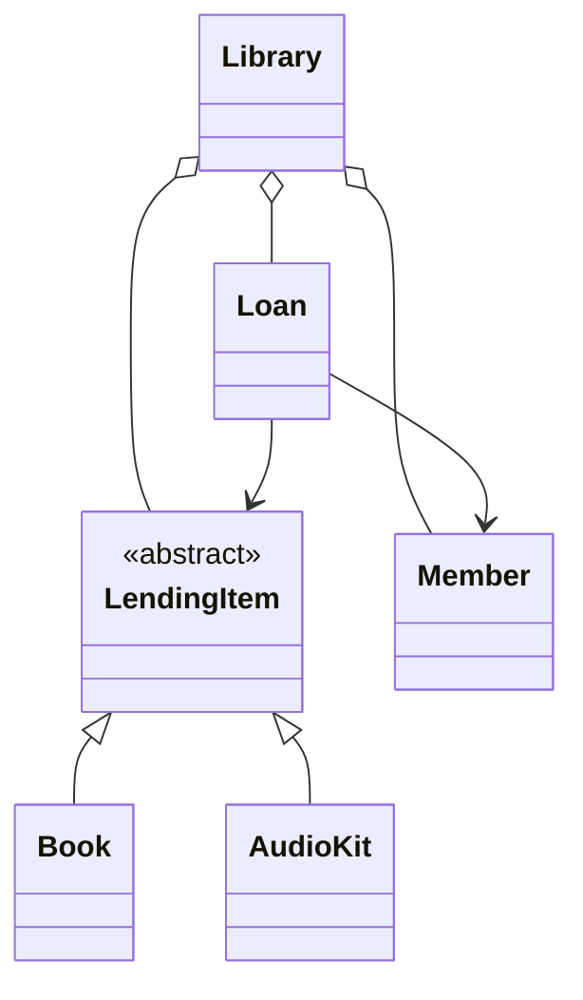

# Diagnosis

## Defect 1 (Most Serious Defect)

**Problem:** The rule of an item being on only one loan at a time is broken.

**Location:** In the main function, both `lib.borrow(kofi, novel)` and `lib.borrow(ama, novel)` succeed even though the same book has already been loaned out.

**Root Cause:** The `borrow()` method does not validate whether an item is already on loan before creating a new loan.

**Impact:** This can create multiple active loans for the same item, resulting in incorrect inventory reporting and conflicting borrower records. This is the most serious defect because it directly breaks a core business rule and causes unreliable data.

---

## Defect 2

**Problem:** Public access modifiers are used for most fields.

**Location:** Across multiple classes (`LendingItem`, `Member`, `Loan`, etc.), for example:

```java
public String name;
public int id;
```

**Root Cause:** Internal object state is exposed directly instead of being controlled through methods.

**Impact:** Any part of the application can modify important data without validation. This makes bugs harder to prevent and increases the risk of accidental state corruption.

---

## Defect 3

**Problem:** Special types and statuses are stored as strings.

**Location:** Examples include:

```java
this.status = "ACTIVE";
```

and

```java
m.kind.equals("STUDENT")
```

**Root Cause:** Business concepts are represented using raw strings instead of dedicated types.

**Impact:** Typographical errors can introduce bugs that are only detected at runtime. The approach also makes future changes harder to implement safely.

---

## Defect 4

**Problem:** Lending rules are hard-coded into the borrowing process.

**Location:**

```java
if (item.type.equals("BOOK"))
```

and

```java
else if (item.type.equals("AUDIO_KIT"))
```

inside `borrow()`.

**Root Cause:** Loan-period logic for different item types is centralized inside the `Library` class.

**Impact:** Adding new item types requires modifying existing logic, increasing the risk of breaking working functionality. This is particularly important because the brief mentions future digital items.

---

## Defect 5

**Problem:** Loans are tracked using names and titles instead of object references.

**Location:**

```java
public String memberName;
public String itemTitle;
```

in the `Loan` class.

**Root Cause:** Relationships are stored as text values rather than references to the actual `Member` and `LendingItem` objects.

**Impact:** Duplicate member names or item titles can cause ambiguity, making records unreliable and more difficult to maintain.

---

## Defect 6

**Problem:** The `Library` class has too many responsibilities.

**Location:** The `Library` class manages members, items, loans, borrowing rules, returns, and reporting.

**Root Cause:** Multiple responsibilities have been combined into a single class.

**Impact:** Changes become riskier because unrelated functionality is tightly coupled. This increases the risk behind maintenance and makes future enhancements difficult.

---

# Initial Design Direction



### Design Goals

- Move lending behaviour into appropriate classes instead of hard-coding item types inside `Library`.
- Use encapsulation by making fields private and exposing behaviour through methods.
- Store relationships using object references rather than names and titles.
- Ensure an item cannot have more than one active loan at a time.
- Support future item types (such as digital items) through inheritance and polymorphism without requiring major changes to existing code.